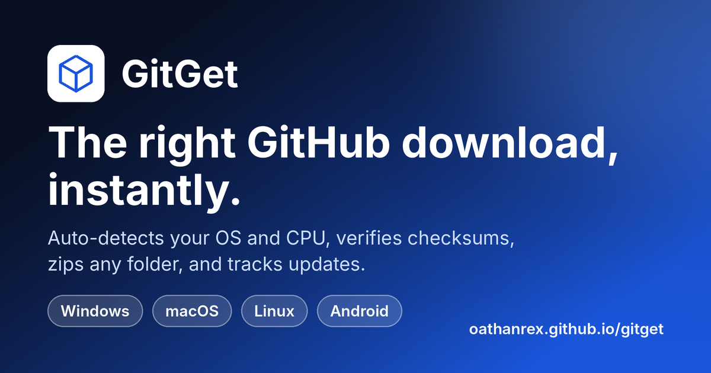

# GitGet 📦

**The simplest way to download GitHub apps.** No more digging through "Assets" or checking if a `.dmg` works on Windows. GitGet auto-detects your system and serves the right installer instantly.

[**🔴 Live Demo**](https://oathanrex.github.io/gitget/)

  

## ✨ Features

- **🚀 Instant Downloads** - Finds the correct installer for your OS (Windows, macOS, Linux, Android) automatically.
- **🔍 Universal Search** - Search any repository by name (e.g., `vscode` or `microsoft/vscode`).
- **📚 My Library** - Track your favorite apps and check for updates in one click.
- **🛡️ Secure & Direct** - All downloads come directly from GitHub releases. No third-party hosting.
- **🌙 Dark Mode** - Automatically syncs with your system preference.
- **⚡ SEO Friendly** - Optimized for discoverability with JSON-LD rich snippets.

## 🛠️ Tech Stack

- **Frontend:** Vanilla JS (ES Modules), HTML5, CSS3 (Variables).
- **API:** GitHub REST API.
- **Storage:** LocalStorage for library persistence.
- **Zero Dependencies:** No frameworks, no build steps, just pure web capability.

## 🤝 Contributing

Contributions are welcome! If you find a bug or want to improve the detection logic:
1.  Fork the repo.
2.  Create a branch (`patch-detection-logic`).
3.  Submit a Pull Request.

## ❤️ Support

GitGet is free forever. If it saves you time, consider buying me a coffee:

---
*Built with ❤️ by [Oathan Rex](https://github.com/oathanrex)*
